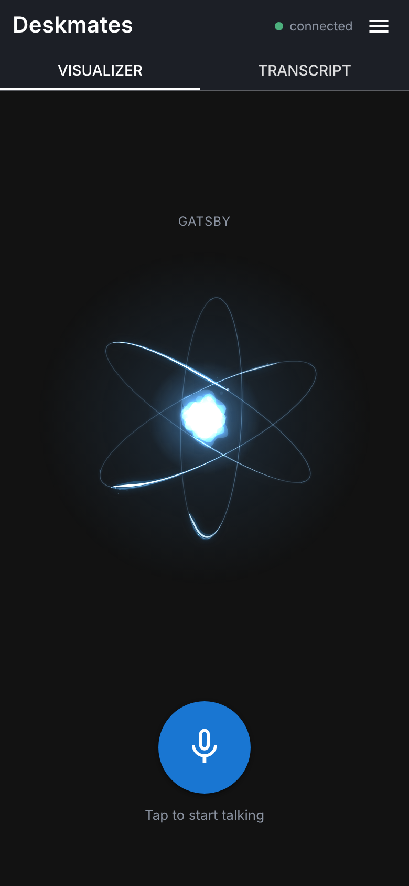
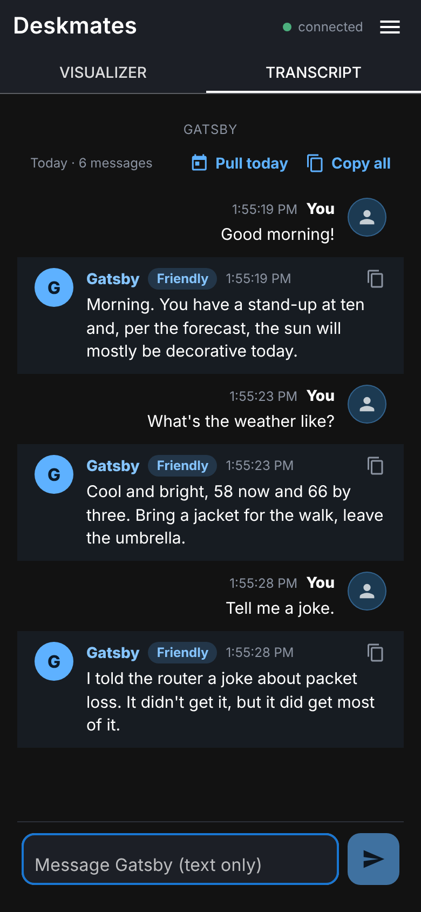
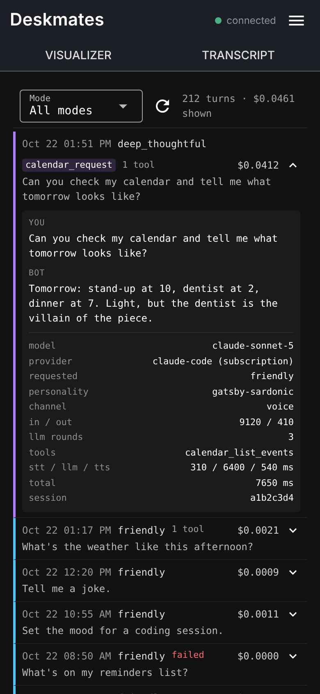
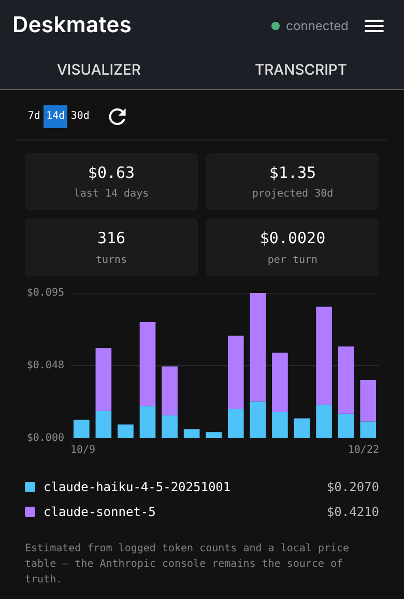
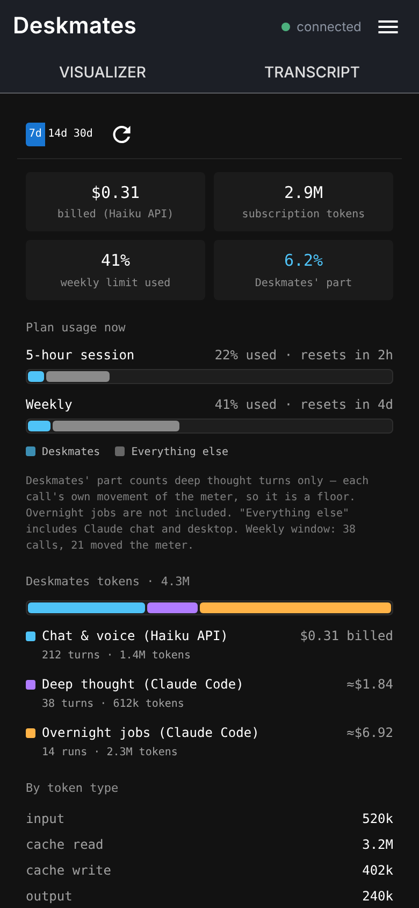
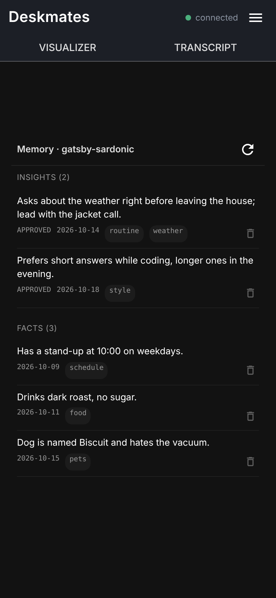

# Deskmates

A multi-personality AI desk companion. Deskmates is a Node.js WebSocket backend
that turns a desk robot, or the included mobile web app, into a voice
assistant with a swappable character. Speech goes in, Claude does the thinking,
and ElevenLabs voices the reply in the character's own voice.

<p align="center">
  
  
  
</p>

<sub>Screenshots use mock data.</sub>

## What it does

- **Custom personalities.** A character is a folder: a system prompt, an
  ElevenLabs voice, and a set of pre-generated canned lines. Add a folder and
  it shows up. No code change and no restart. A coverage check reports gaps
  before you switch to a half-built character.
- **Voice pipeline.** Speech-to-text and text-to-speech through ElevenLabs,
  with Anthropic models in the middle. A fast model handles everyday chat, and
  a larger one takes over for long, considered answers when you ask it to
  "think it through".
- **Canned responses for the instant stuff.** Greetings, fillers, jokes and
  status lines are pre-generated audio picked at random, so they play with no
  model call and no latency.
- **Tool use with guardrails.** Web search, GitHub, Gmail (read-only) and
  Google Calendar. Anything that writes is gated: GitHub changes use a
  propose-then-confirm step on a later turn, and calendar creation only
  happens when you ask for it in that same turn. Unrecognized or hostile modes
  never get tools.
- **Long-term memory.** Facts you ask it to remember are saved per
  personality, and a small classifier decides when an utterance is a memory
  request. Every fact and insight can be reviewed and deleted from the web app.
- **Cost and latency visibility.** Every turn is logged with its model, token
  counts, tool calls, per-stage timings and cost. The web app charts daily
  spend by model and shows plan usage.
- **Task queue in the web app.** A Tasks view lists pending and finished self-build
  tasks, and a task can include a photo for the bot to look at.
- **A self-build pipeline.** A nightly job proposes improvements as task files,
  you approve them, and Claude implements them in an isolated git worktree
  behind a test gate. See [Engineering notes](#engineering-notes).

## Architecture

```
 desk robot / web app
        |  WebSocket (token-authenticated)
        v
 server.js --> speech pipeline --> ElevenLabs STT
                    |                    |
                    |               transcript
                    v                    v
              mode + personality --> Anthropic (Messages API or Agent SDK)
                    |                    |
                    |               tool loop: web, GitHub, Gmail, Calendar
                    v                    v
              canned audio  <--  ElevenLabs TTS  --> audio back to the client
                    |
                    +--> turn log (SQLite): tokens, cost, timings, tool calls
```

| Area | Where |
|---|---|
| WebSocket server, auth, connection cap | `server.js`, `src/auth.js`, `src/connectionCap.js` |
| Speech pipeline and TTS chunking | `src/speechPipeline.js`, `src/speechStream.js`, `src/ttsChunking.js` |
| Extended-thinking mode and tool loop | `src/deepThoughtful.js`, `src/tools/` |
| Memory | `src/longTermMemory.js`, `src/sessionMemory.js` |
| Turn log and cost stats | `src/turnLog.js`, `src/turnStats.js` |
| Personalities | `personalities/<name>/` |
| Web app (Vue 3 + Quasar) | `webapp/` |
| Desk robot firmware (ESP32-S3, C++) | `firmware/` |

## Desk robot

`firmware/` holds ESP32-S3 firmware that connects a CircuitMess Deskmates desk robot to
this server: Wi-Fi and WebSocket link, streamed speech in and PCM audio out, a custom wake
phrase, filler lines for slow replies, and an experimental turn-toward-the-speaker feature.
It is a fork of CircuitMess's MIT-licensed
[Deskmates firmware](https://github.com/CircuitMess/Deskmates-Firmware-Public). See
[firmware/README.md](firmware/README.md). The web app works without any hardware.

## More screenshots

<p align="center">
  
  
  
</p>

## Getting started

Requirements: Node 22, an Anthropic API key, and an ElevenLabs API key.

```bash
npm install
cp .env.example .env   # then fill in ANTHROPIC_API_KEY, ELEVENLABS_API_KEY, BOT_AUTH_TOKEN
npm start
```

`BOT_AUTH_TOKEN` is a shared secret (for example `openssl rand -hex 32`). The
server refuses to start without it. Clients send it in the
`X-Butterbot-Token` header (or a `?token=` query parameter) when they open the
WebSocket. The header name is a leftover from the project's earlier name and is
kept so existing firmware keeps working.

To try the web app:

```bash
cd webapp
npm install
npm run build        # outputs webapp/dist, serve it from any static host
```

The full setup guide covers Gmail and Calendar OAuth, generating canned audio,
adding a personality, memory and operations. See [docs/SETUP.md](docs/SETUP.md).
For a plain-language list of what the bot can do, see
[CAPABILITIES.md](CAPABILITIES.md).

## Tests

```bash
npm test             # both suites, fully offline
```

There are roughly 790 tests across two suites that need no network and no API
keys. `tests/green/` checks that valid input behaves as documented, and
`tests/adversarial/` checks that malformed, hostile or out-of-order input fails
safely.

## Engineering notes

- **Test gate.** Every code change, including the ones the bot writes for
  itself, must add tests to both suites, and every added line under `src/` must
  be executed by them. Failures are fed back until clean. If the same failure
  recurs across three rounds, the change is discarded. Git hooks refuse merges
  and pushes of code that hasn't passed. Details in
  [TESTING-GATE.md](TESTING-GATE.md).
- **Design choices.** Deterministic code handles everything that doesn't need a
  model. Canned audio replaces model calls for common lines. Writes to
  external accounts need explicit confirmation, and modes with untrusted input
  get no tools at all.
- **Observability.** Per-turn cost, token and timing logs back the web app's
  Costs, Usage and Turns views, so spend and latency regressions are visible.

## License

The server and web app are MIT licensed, see [LICENSE](LICENSE). `firmware/` is a
fork of CircuitMess's MIT-licensed firmware and keeps its original notice; see
[firmware/README.md](firmware/README.md). Third-party characters and branding are
not part of either license.
